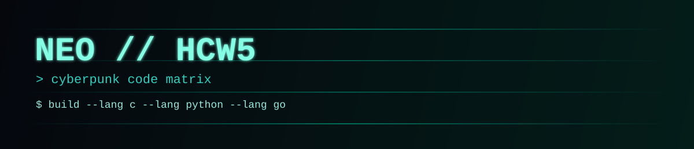

<div align="center">
  
</div>

<p align="center">
  
</p>

<div align="center">

```text
$ whoami
hcw5 :: building in C, Python, and Go
$ echo "welcome to the neo dev grid"
```

</div>

## 📊 Neo Stats Dashboard

<div align="center">
  
  
  
  
</div>

<div align="center">
  
  
  
</div>

## 🧪 Language Focus (C / Python / Go)

<div align="center">
  
  
  
</div>

- **C, Python, and Go** are highlighted above as primary focus languages.
- **C/Python/Go repo metrics** above are pulled from GitHub Search API counts via Shields dynamic badges.
- GitHub profile READMEs do not expose exact built-in per-language contribution totals for only C/Python/Go, so repository-count badges are used as a stable GitHub-compatible approach.

## ℹ️ Profile Visibility Notes

- Your profile README appears on `github.com/hcw5` only when this repository is **public**, named exactly `hcw5`, and this README is on the repository **default branch**.
- If changes only appear inside the repo page, merge the branch into the default branch and confirm repository visibility settings.

## 🔗 Connect

<div align="center">
  <a href="https://github.com/hcw5">
    
  </a>
</div>

<p align="center">
  <i>"The best time to plant a tree was 20 years ago. The second best time is now." 🌱</i>
</p>
